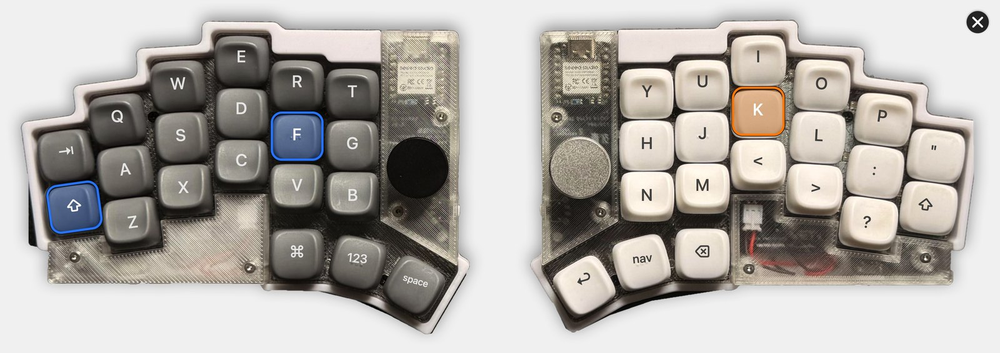
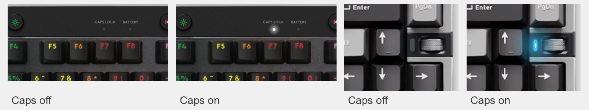
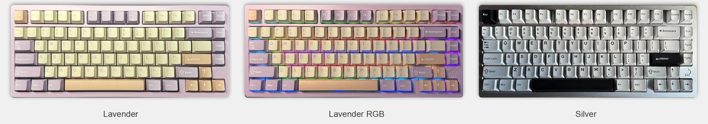
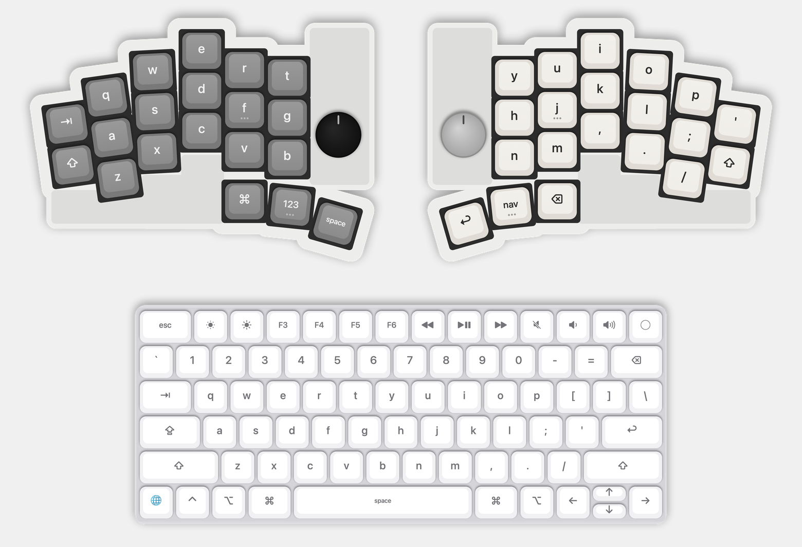
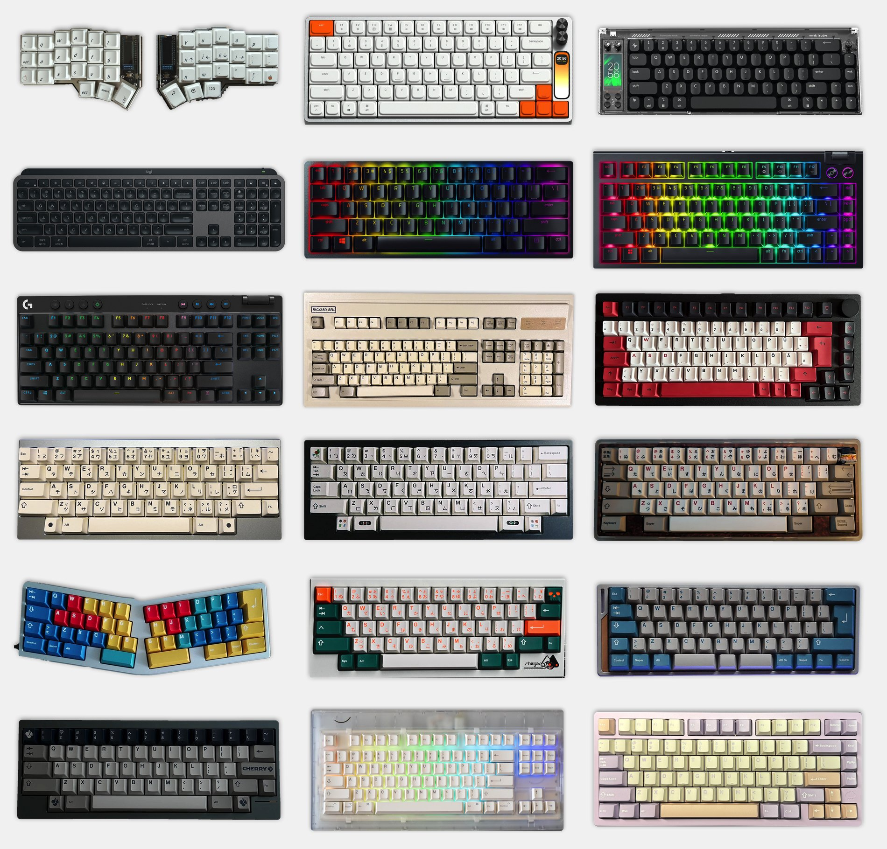
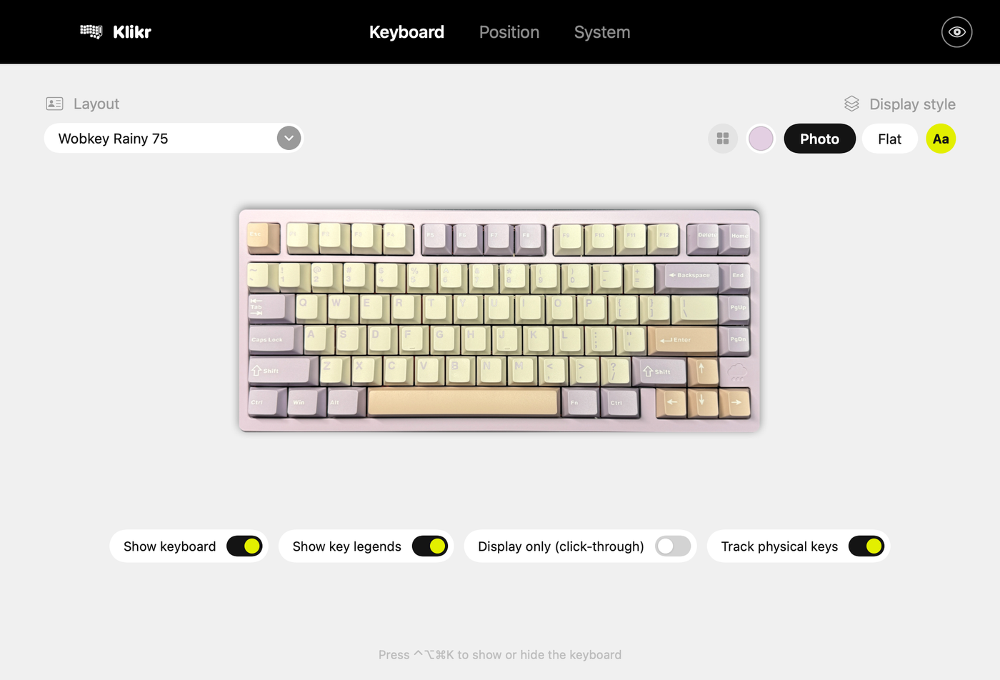
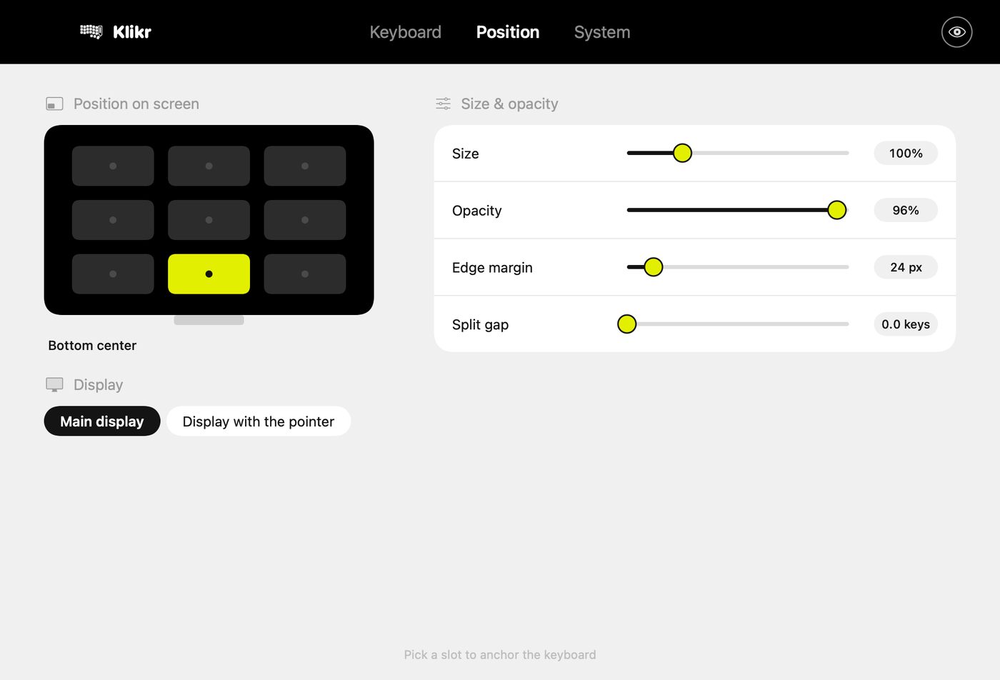
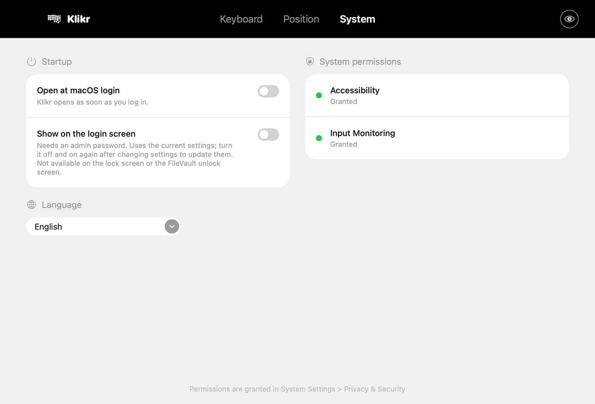

# Klikr

English | [Tiếng Việt](README.vi.md)

An on-screen keyboard for macOS that looks exactly like a real keyboard. Klikr shows your keyboard from a real photo, types like a real keyboard, and lights up the keys you press on your physical keyboard as you type.

## Features

- **Photo-real keyboards.** Each board is shown from a real photo, seen straight from above, with every key exactly where it is on the real thing. A pressed key sinks into the case.
- **Types for real.** Clicking a key types into the app you are using, without taking focus. It works with input methods like EVKey for Vietnamese, and holding a key auto-repeats it at the system rate.
- **Mirrors your physical keyboard.**
  - Keys you press on the real keyboard light up in blue; virtual presses and latched keys light up in orange.
  - Shift swaps legends to their shifted characters.
  - When a physical key sends a character from another layer (a ZMK board on its number layer, for example), Klikr shows that layer while you hold it.
- **Real indicator lights.** Caps Lock lights the board's own LED where it has one. Boards with per-key RGB glow the Caps key instead; other boards get a small light in the corner of the key.

  
- **Manufacturer colourways.** Boards photographed in several official colours can switch between them from the colour button next to "Photo".

  
- **Flat style.** Every layout can also be drawn as a clean vector keyboard.

  
- **Layers, sticky modifiers and knobs.**
  - Tap a modifier once for one key, twice to lock it.
  - Layer keys (`123`, `nav`) work the same way.
  - Click the left or right half of a knob to turn it, and its centre to press it.
- **Live screens.** Keyboards with a screen show the real time, date, battery and Bluetooth state.
- **Login window.** Klikr can also appear on the macOS login screen (typing there is still experimental).
- **Languages.** The interface is in English, Tiếng Việt, 日本語, 中文 and 한국어, or follows macOS.

### Included keyboards

| Layout | Keyboard |
|---|---|
| `split40` | Split 40 with two knobs |
| `corne` | Corne 42 |
| `alice` | Alice 40 |
| `unisplit` | Unibody split |
| `hhkb-tofu`, `hhkb-kana` | 60% HHKB |
| `pink60` | 60% with artisan keycaps |
| `65-creator` | 65% with a screen module |
| `iso65` | 65% ISO German |
| `75-orange` | 75% with two knobs and a screen |
| `tkl-frost`, `tkl-frost-rgb` | TKL in a frosted case (LEDs off / on) |
| `magic` | Apple Magic Keyboard with Touch ID |
| `mx-keys-s` | Logitech MX Keys S (Graphite, Pale Gray, Black) |
| `pro-x-tkl` | Logitech G Pro X TKL (Black, White, Magenta) |
| `huntsman-mini` | Razer Huntsman Mini (Black, Mercury) |
| `blackwidow-v4x` | Razer BlackWidow V4 X with macro keys |
| `blackwidow-v4-75` | Razer BlackWidow V4 75% |
| `nut75` | Weikav Nut75 with roller (Orange, Silver) |
| `nut65` | Weikav Nut65 |
| `rainy75` | Wobkey Rainy 75 (Lavender, Lavender RGB, Silver) |
| `15-teal60` | 60% ISO, teal and grey |
| `19-packard-bell` | Packard Bell 101, retro full-size |
| `20-hhkb-cream` | 60% HHKB with cream kana keycaps |
| `21-zhuyin` | 60% with Zhuyin keycaps |
| `23-iso75-red` | 75% ISO German, red and white, with a knob |
| `24-hiragana` | 60% with red hiragana legends |
| `25-cherry60` | Cherry 60% HHKB, grey |

## Settings

Open Settings from the menu bar icon. While Settings is open, Klikr also shows in the Dock.

| Position | System |
|---|---|
|  |  |

- **Keyboard:**
  - layout
  - photo or flat style
  - colourway
  - key legends on or off
  - show or hide the keyboard
  - display only (clicks pass through)
  - track physical keys
- **Position:**
  - nine anchor points, or drag the case anywhere
  - main screen or the screen under the pointer
  - margin, size, opacity
  - gap between split halves
- **System:**
  - open at login
  - show on the login screen
  - interface language
  - permissions

## Install

Download `Klikr.zip` from [Releases](../../releases), unzip it, and move `Klikr.app` to `/Applications`. The build is signed but not notarized, so the first time, right-click the app and choose **Open**.

On first launch Klikr:
1. Registers itself to open at login (you can turn this off in Settings).
2. Asks for **Accessibility** (to send keys) and **Input Monitoring** (to see physical key presses).
3. Opens Settings.

## Usage

| Action | Result |
|---|---|
| Click a key | Types into the active app without stealing focus. Hold to auto-repeat |
| Click a modifier (⇧⌃⌥⌘) | Once: sticks for the next key. Twice: locks. Three times: off |
| Click a layer key (`123`, `nav`) | Once: layer for the next key. Twice: locks the layer. Three times: back to base |
| Click the left / right half of a knob | Turn it (volume or brightness by default). Click the centre to press it |
| Drag the case | Moves the keyboard; position switches to "Free" |
| Right-click | Quick menu (layout, position, settings) |
| ⌃⌥⌘K | Show or hide the keyboard |

Key legends follow the active macOS input source (ABC, Dvorak, Vietnamese and others).

## Limitations

- **Login window:** turn on "Show on the login screen" in Settings (needs an admin password). Klikr cannot appear on the FileVault unlock screen, which runs before macOS starts, or on the lock screen. Use the Accessibility Keyboard there instead: System Settings > Lock Screen > Accessibility options.
- **Password fields:** while a password field has focus, macOS stops every app from seeing key presses, so physical keys are not highlighted until you leave the field.
