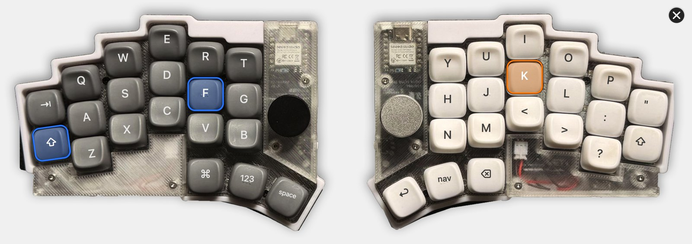
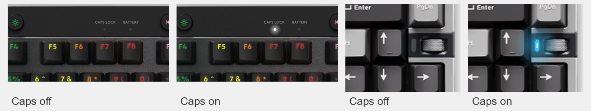
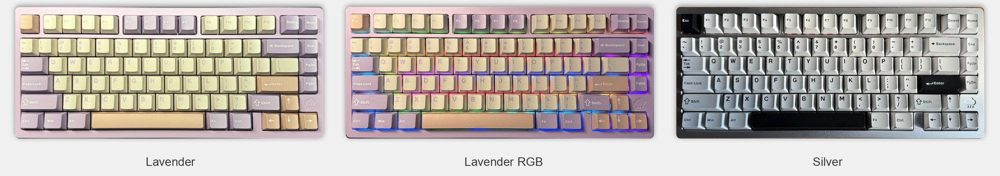
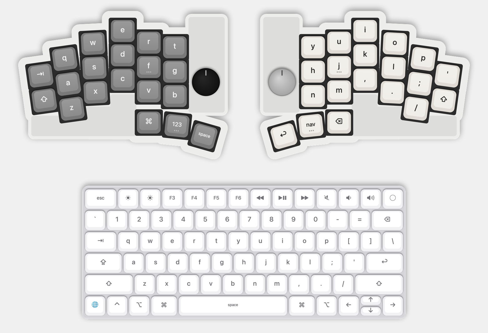
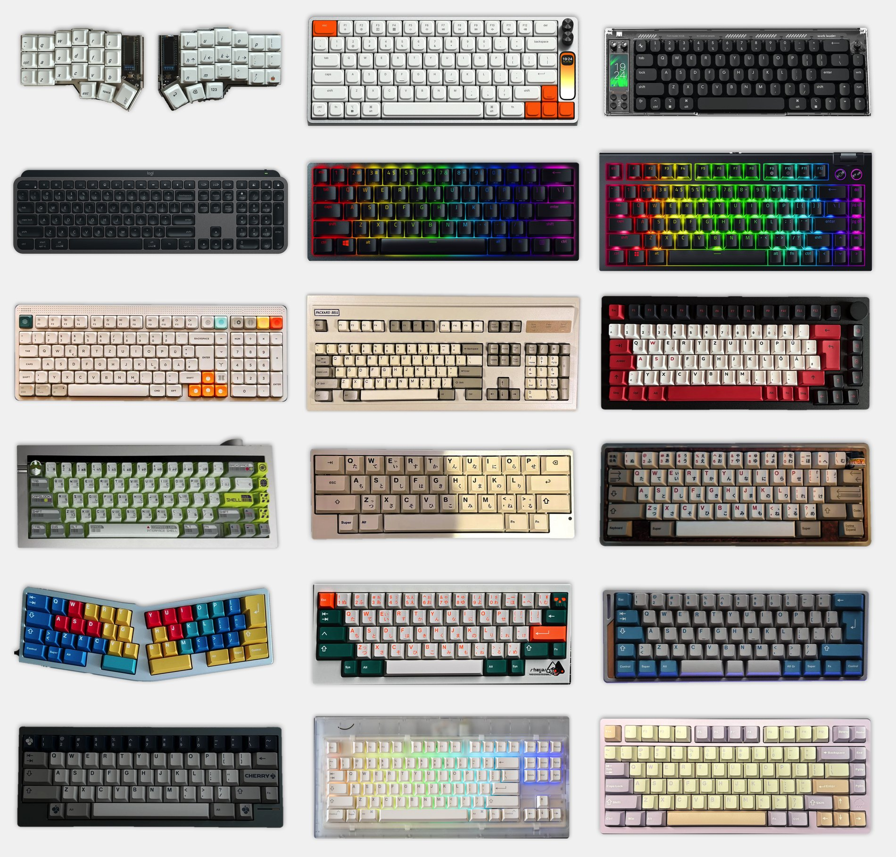
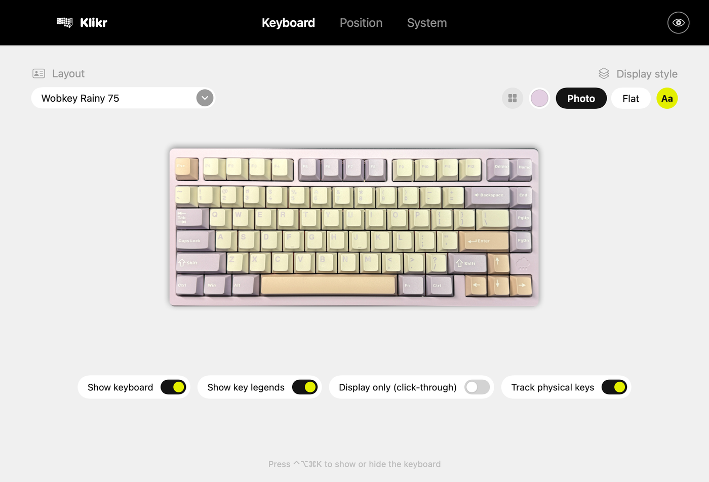
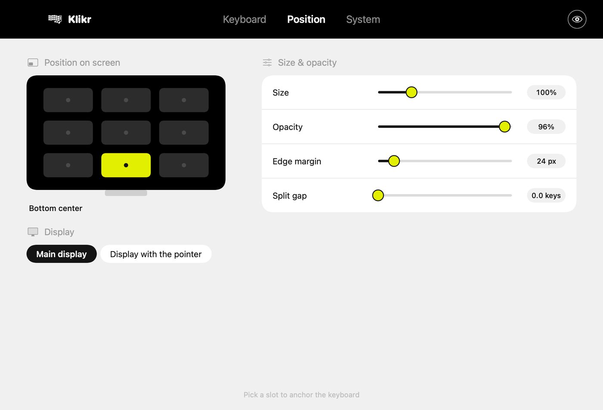
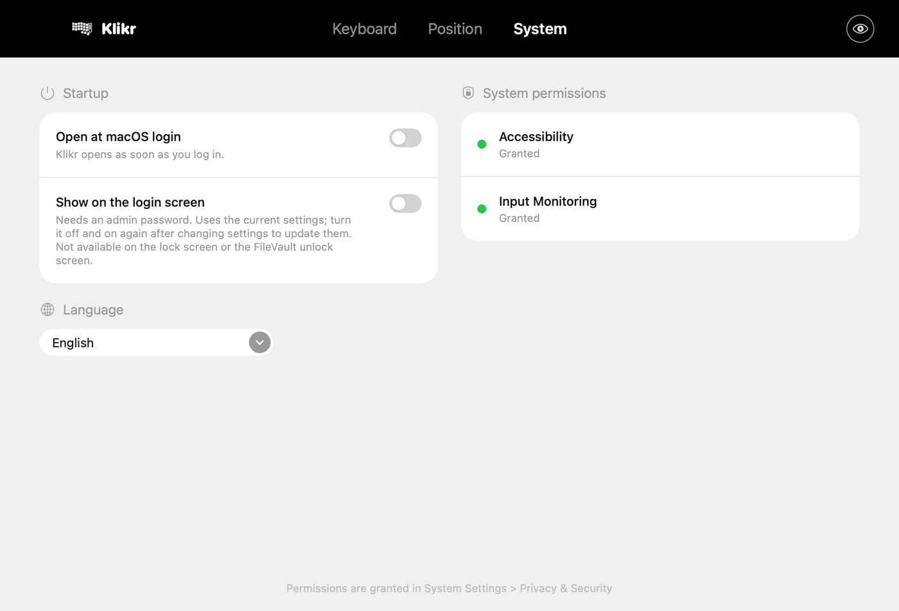

# Klikr

[English](README.md) | Tiếng Việt

Bàn phím ảo cho macOS, trông y hệt bàn phím thật. Klikr hiển thị bàn phím bằng chính ảnh chụp thật, gõ được như bàn phím thật, và sáng lên đúng những phím bạn đang bấm trên bàn phím vật lý.

## Tính năng

- **Bàn phím ảnh thật.** Mỗi bàn phím hiển thị từ ảnh chụp thật, nhìn thẳng từ trên xuống, từng phím nằm đúng vị trí như ngoài đời. Phím được bấm sẽ lún xuống.
- **Gõ thật.** Bấm vào phím là gõ vào app đang dùng mà không cướp focus. Gõ được cả với bộ gõ tiếng Việt như EVKey. Giữ phím thì tự lặp theo tốc độ của hệ thống.
- **Phản chiếu bàn phím thật.**
  - Phím bạn bấm trên bàn phím thật sáng xanh dương; phím bấm trên bàn phím ảo hoặc đang khoá sáng cam.
  - Giữ Shift thì nhãn đổi sang ký tự shift.
  - Nếu phím thật gửi ký tự ở layer khác (ví dụ bàn phím ZMK đang ở layer số), Klikr tự hiện layer đó trong lúc bạn giữ phím.
- **Đèn báo như máy thật.**
  - Bật Caps Lock thì đèn của chính bàn phím đó sáng lên.
  - Bàn phím RGB từng phím thì phím Caps phát sáng.
  - Bàn phím không có đèn riêng thì có một đèn nhỏ ở góc phím Caps.

  
- **Màu của hãng.** Bàn phím có ảnh chụp ở nhiều màu chính hãng thì đổi màu được bằng nút tròn cạnh "Ảnh thật".

  
- **Kiểu vẽ phẳng.** Mọi bàn phím đều hiển thị được dạng vẽ phẳng gọn gàng.

  
- **Layer, phím dính và núm xoay.**
  - Bấm phím bổ trợ 1 lần để dùng cho phím kế tiếp, 2 lần để khoá.
  - Phím layer (`123`, `nav`) cũng vậy.
  - Bấm nửa trái hoặc nửa phải núm xoay để xoay, bấm vào tâm để nhấn.
- **Màn hình hiển thị thật.** Bàn phím có màn hình sẽ hiện giờ, ngày, pin và Bluetooth thật.
- **Màn hình đăng nhập.** Klikr có thể hiện ở màn hình đăng nhập của macOS (gõ phím ở đó vẫn đang thử nghiệm).
- **Ngôn ngữ.** Giao diện có Tiếng Việt, English, 日本語, 中文, 한국어, hoặc theo ngôn ngữ của macOS.

### Các bàn phím có sẵn

| Layout | Bàn phím |
|---|---|
| `split40` | Split 40 phím, 2 núm xoay |
| `corne` | Corne 42 phím |
| `alice` | Alice 40 |
| `unisplit` | Split một khối |
| `hhkb-tofu`, `hhkb-kana` | 60% HHKB |
| `pink60` | 60% keycap artisan |
| `65-creator` | 65% có module màn hình |
| `iso65` | 65% ISO tiếng Đức |
| `75-orange` | 75% có 2 núm xoay và màn hình |
| `tkl-frost`, `tkl-frost-rgb` | TKL vỏ nhựa mờ (tắt / bật LED) |
| `magic` | Apple Magic Keyboard có Touch ID |
| `mx-keys-s` | Logitech MX Keys S (Graphite, Pale Gray, Black) |
| `pro-x-tkl` | Logitech G Pro X TKL (Black, White, Magenta) |
| `huntsman-mini` | Razer Huntsman Mini (Black, Mercury) |
| `blackwidow-v4x` | Razer BlackWidow V4 X có phím macro |
| `blackwidow-v4-75` | Razer BlackWidow V4 75% |
| `nut75` | Weikav Nut75 có con lăn (Orange, Silver) |
| `nut65` | Weikav Nut65 |
| `rainy75` | Wobkey Rainy 75 (Lavender, Lavender RGB, Silver) |
| `15-teal60` | 60% ISO, xanh mòng két và xám |
| `16-lime65` | 65% keycap artisan xanh chanh, có núm xoay |
| `17-white-96` | 96% trắng, phím mũi tên cam, layout Mac tiếng Đức |
| `18-black65` | 65% đen, phím hoa tulip |
| `19-packard-bell` | Packard Bell 101, full-size cổ điển |
| `20-hhkb-cream` | 60% HHKB keycap kana màu kem |
| `21-zhuyin` | 60% keycap chú âm (Zhuyin) |
| `22-lilac40` | 40% vỏ trắng và tím lilac |
| `23-iso75-red` | 75% ISO tiếng Đức, đỏ trắng, có núm xoay |
| `24-hiragana` | 60% chữ hiragana đỏ |
| `25-cherry60` | Cherry 60% HHKB màu xám |
| `26-kanji40` | 40% màu kem, phím chức năng chữ Hán |

## Cài đặt

Mở Cài đặt từ biểu tượng trên thanh menu. Khi Cài đặt đang mở, Klikr cũng hiện trên Dock.

| Vị trí | Hệ thống |
|---|---|
|  |  |

- **Bàn phím:**
  - chọn layout
  - ảnh thật hoặc vẽ phẳng
  - màu của hãng
  - bật hoặc tắt ký tự trên phím
  - ẩn hoặc hiện bàn phím
  - chỉ hiển thị (click xuyên qua)
  - theo dõi phím thật
- **Vị trí:**
  - 9 điểm neo, hoặc kéo vỏ đến chỗ bất kỳ
  - màn hình chính hoặc màn hình đang có con trỏ
  - cách mép, kích thước, độ trong
  - khoảng tách giữa hai nửa
- **Hệ thống:**
  - mở cùng macOS
  - hiện ở màn hình đăng nhập
  - ngôn ngữ giao diện
  - cấp quyền

## Cài app

Tải `Klikr.zip` ở mục [Releases](../../releases), giải nén rồi kéo `Klikr.app` vào `/Applications`. App đã được ký nhưng chưa được Apple notarize, nên lần đầu hãy bấm chuột phải vào app và chọn **Open**.

Lần chạy đầu Klikr sẽ:
1. Đăng ký mở cùng macOS (tắt được trong Cài đặt).
2. Xin quyền **Trợ năng** (để gửi phím) và **Giám sát đầu vào** (để thấy phím thật đang bấm).
3. Mở cửa sổ Cài đặt.

## Cách dùng

| Thao tác | Kết quả |
|---|---|
| Bấm một phím | Gõ vào app đang dùng mà không cướp focus. Giữ để tự lặp |
| Bấm phím bổ trợ (⇧⌃⌥⌘) | 1 lần: dính cho phím tiếp theo. 2 lần: khoá. 3 lần: tắt |
| Bấm phím layer (`123`, `nav`) | 1 lần: dùng layer cho phím tiếp theo. 2 lần: khoá layer. 3 lần: về layer gốc |
| Bấm nửa trái / phải núm xoay | Xoay (mặc định chỉnh âm lượng hoặc độ sáng). Bấm vào tâm để nhấn |
| Kéo phần vỏ | Di chuyển bàn phím, vị trí chuyển sang "Tự do" |
| Chuột phải | Menu nhanh (layout, vị trí, cài đặt) |
| ⌃⌥⌘K | Ẩn hoặc hiện bàn phím |

Ký tự trên phím đổi theo bộ gõ macOS đang chọn (ABC, Dvorak, Vietnamese...).

## Giới hạn

- **Màn hình đăng nhập:** bật "Hiện ở màn hình đăng nhập" trong Cài đặt (cần mật khẩu admin). Klikr không hiện được ở màn hình mở khoá FileVault (chạy trước khi macOS khởi động) và màn hình khoá máy. Ở những chỗ đó hãy dùng Bàn phím Trợ năng: Cài đặt hệ thống > Màn hình khoá > Tuỳ chọn trợ năng.
- **Ô mật khẩu:** khi ô mật khẩu đang được chọn, macOS chặn mọi app xem phím đang bấm, nên phím thật không sáng lên cho tới khi bạn rời ô đó.
